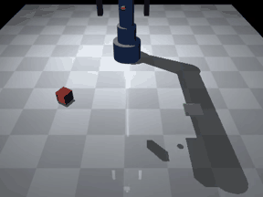
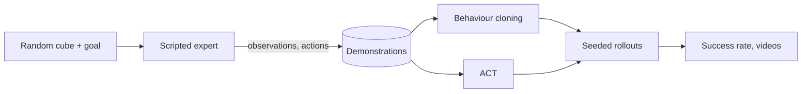

<h1 align="center">Robot arm imitation learning</h1>

<p align="center">
A simulated MuJoCo arm learns pick-and-place from demonstrations: scripted expert, behaviour cloning and action-chunking transformers, compared on seeded rollouts.
</p>

<p align="center">
<a href="https://github.com/haroonkhan02/robot-arm-imitation-learning/actions/workflows/ci.yml"></a>


</p>

<p align="center"></p>

> **Work in progress.** The simulator, the scripted expert and the demonstration pipeline are
> done and tested. Policy training (a behaviour-cloning baseline, then ACT) and the
> comparison between them are next; the results table below only has the expert so far.

## What it does

- A 5-joint arm with a two-finger gripper picks up a cube at a random position and orientation and puts it on a marker at a random goal position (MuJoCo, 20 Hz control).
- A scripted expert (Cartesian waypoints, damped-least-squares IK) solves the task and provides the demonstrations. Policies only see observation-action pairs, never the planner.
- Demonstrations are split by episode, so no trajectory appears in both training and evaluation.
- Evaluation will report success rate over seeded episodes the policies never saw.



## Results so far

| Controller | Success (300 unseen seeds) | Mean episode length |
|---|---|---|
| Scripted expert | 100 % | 122 steps (6.1 s) |
| Scripted expert, 0.03 rad noise on executed joint targets | 84.7 % | 142 steps |

The noisy row matters for learning: a policy that is a little off the expert's path ends up in
states the clean demonstrations never visit, and the same expert already drops the cube
15 % of the time there. Collecting demonstrations with noise (recorded actions stay clean) is
supported through `--exec-noise`.

## Getting started

```bash
uv venv --python 3.12 && source .venv/bin/activate
uv pip install -e ".[dev]"
pytest -q                                   # simulator tests, CPU only

ra-collect --episodes 600 --out data/demos_clean.npz    # about 15 s
ra-expert-eval --episodes 300 --video demo.mp4          # success rate + video
```

Observations are a 13-vector (joints, gripper opening, cube pose, goal), actions are five
absolute joint targets plus a gripper command. `PickPlaceEnv.render("front" | "top")` returns
camera images for vision-based policies.

## Repository structure

```text
src/robot_arm_il/
  assets/arm_pick_place.xml   MuJoCo model: arm, gripper, cube, goal marker, cameras
  config.py                   dimensions and task randomisation ranges
  env.py                      PickPlaceEnv (reset / step / render)
  kinematics.py               damped-least-squares IK for the gripper site
  expert.py                   scripted pick-and-place expert, run_episode()
  dataset.py                  episode storage, episode-level splits, normalisation
  collect.py                  ra-collect: generate demonstrations
  expert_eval.py              ra-expert-eval: expert success rate and video
tests/                        46 tests (env, IK, expert, dataset)
reports/                      expert baseline numbers
```

## Design decisions

- **Own environment instead of a packaged benchmark.** I wanted full control over the task, the physics and the expert, and a simulator fast enough (about 5,000 control steps per second with the expert and its IK on a laptop CPU) that hundreds of rollouts per evaluation are cheap.
- **Joint-position actions.** The policy outputs absolute joint targets, as in ACT and ALOHA, rather than end-effector deltas, so it never needs the IK solver.
- **Four equivalent grasp yaws.** The cube and the gripper are both symmetric under 90-degree turns. IK from the home pose can pick the solution that winds the wrist roll into its limit, so the expert solves all four and keeps the smallest roll.
- **Finger armature.** With light fingers the grip force chattered and the cube slid out during transport (35 of 40 seeds). Giving the finger joints some armature fixed it without changing the control gains much.

## Limitations and next steps

- The task is state-based pick-and-place with one cube in a small workspace; there is no sim-to-real transfer.
- The expert is privileged (it reads the true cube pose), so a vision policy has to infer the pose from pixels.
- Planned: behaviour-cloning MLP, ACT, success rate versus number of demonstrations, failure analysis, rollout videos.

## License

MIT, see [LICENSE](LICENSE).
