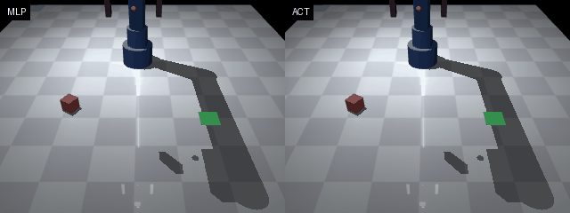
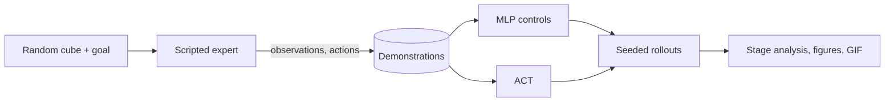
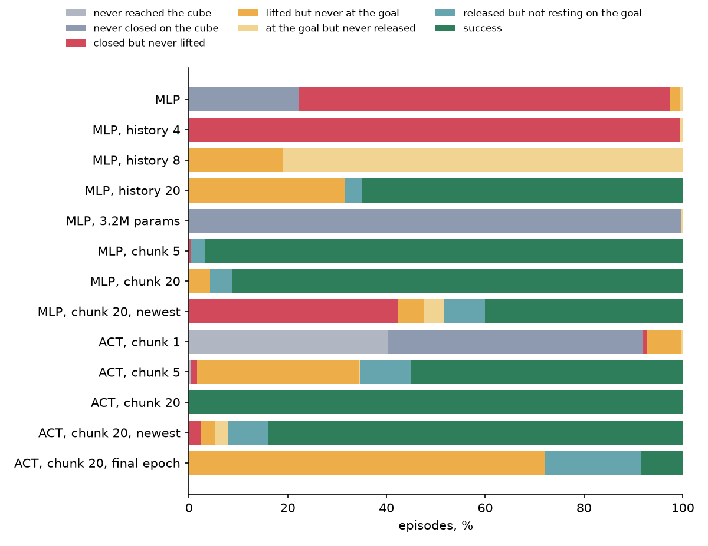

<h1 align="center">Robot arm imitation learning</h1>

<p align="center">
A simulated MuJoCo arm learns pick-and-place from demonstrations. Controlled experiments compare behaviour cloning with action-chunking transformers (ACT) to find out which part of ACT does the work.
</p>

<p align="center">
<a href="https://github.com/haroonkhan02/robot-arm-imitation-learning/actions/workflows/ci.yml"></a>


</p>

<p align="center"></p>

## What it does

- A 5-joint arm with a two-finger gripper picks up a cube at a random position and orientation and puts it on a marker at a random goal position (MuJoCo, 20 Hz control).
- A scripted expert (Cartesian waypoints, damped-least-squares IK) provides 600 demonstrations. Policies only see observation-action pairs, never the planner.
- An MLP and my own state-based ACT are trained on the same data, then scored on 300 unseen layouts per run.
- Control experiments vary one thing at a time: memory, model size, chunk length, ensembling, checkpoint choice, data size and noise.
- Each failed episode is labelled by the first task stage it missed.



## Results

Success on unseen seeds (300 episodes per run) after training on 480 clean demonstrations, for three training seeds. The scripted expert scores 100 %.

| Policy | Parameters | Success per seed | Mean |
|---|---|---|---|
| MLP, next action only | 137k | 0 %, 0 %, 0.3 % | 0.1 % |
| MLP, chunk 5 + ensembling | 143k | 96.7 %, 99.0 %, 72.0 % | 89.2 % |
| MLP, chunk 20 + ensembling | 166k | 91.3 %, 90.0 %, 80.7 % | 87.3 % |
| ACT, chunk 5 + ensembling | 1.3M | 55.0 %, 56.7 %, 2.7 % | 38.1 % |
| ACT, chunk 20 + ensembling | 1.3M | 100 %, 97.0 %, 100 % | 99.0 % |
| ACT, chunk 20, newest chunk only | 1.3M | 84.0 %, 8.3 %, 1.3 % | 31.2 % |
| ACT, chunk 20, final epoch | 1.3M | 8.3 %, 8.3 %, 10.0 % | 8.9 % |

ACT success against the number of training demonstrations (ensembled, mean of three seeds; 120 is one seed):

| Demonstrations | 10 | 20 | 50 | 120 | 480 |
|---|---|---|---|---|---|
| Success | 34.4 % | 76.7 % | 98.8 % | 97.3 % | 99.0 % |

<p align="center"></p>

The plain MLP fails because it has no memory: after closing the gripper the expert waits 8 steps, the state barely changes, and most episodes stop at the cube. A 3.2M-parameter MLP does no better (0 %). Stacking past observations fixes the lift only once the history covers the wait, and even 20 frames reach only 65 % (one seed).

Most of the gain comes from predicting chunks and averaging them, not from the transformer: a 166k-parameter MLP gets close to ACT. Ensembling matters most, because the same models using only the newest chunk drop to 1–84 %. My reading is that older chunks act as memory during the wait, though I have not proved that directly.

ACT is still the best policy here, with two caveats. Its CVAE latent collapsed (KL 0.000 on validation), which fits a deterministic expert, so this is effectively a plain transformer. It also overfits: validation error is lowest near epoch 13 of 50, and the final-epoch weights lift every cube but rarely reach the goal. The 99 % depends on that checkpoint choice.

Under joint noise while executing (0.03 rad), ACT drops to 52 % with clean demonstrations and 67 % with noisy ones, against 85 % for the expert. Details and all other runs are in [reports/analysis.md](reports/analysis.md). The chunk-10, decay, history and noise runs use a single seed.

## Getting started

```bash
uv venv --python 3.12 && source .venv/bin/activate
uv pip install -e ".[dev,train]"
pytest -q                                               # CPU only, no dataset needed

ra-collect --episodes 600 --out data/demos_clean.npz    # about 15 s
ra-train --policy act --epochs 50 --out models/act.pt   # about 7 min on an M-series GPU (MPS)
ra-policy-eval --ckpt models/act.pt --device cpu --out reports/eval_act.json

scripts/run_sweep.sh                                    # demonstration-count and noise sweeps
scripts/run_controls.sh mlp                             # also: act, seeds, chunk5, last, decay, eval
ra-analyse && ra-plots                                  # tables and figures in reports/
```

Observations are a 13-vector (joints, gripper opening, cube pose, goal). Actions are five absolute joint targets plus a gripper command.

## Repository structure

```text
src/robot_arm_il/
  assets/arm_pick_place.xml   MuJoCo model: arm, gripper, cube, goal marker, cameras
  config.py                   dimensions and task randomisation ranges
  env.py                      PickPlaceEnv (reset / step / render)
  kinematics.py               damped-least-squares IK for the gripper site
  expert.py                   scripted pick-and-place expert
  dataset.py                  episode storage, splits, normalisation, chunks, history
  collect.py                  ra-collect: generate demonstrations
  expert_eval.py              ra-expert-eval: expert success rate and video
  policies.py                 MLP (history, chunks) and ACT (CVAE + transformer)
  train.py                    ra-train: training loop and checkpoints
  policy_eval.py              ra-policy-eval: rollouts, temporal ensembling, task stages
  analysis.py                 ra-analyse: intervals, failure stages, seeds, coverage
  stall.py                    ra-stall: copy baseline and frozen-arm probe
  latent.py                   ra-latent: does ACT use its latent?
  plots.py                    ra-plots: figures
  demo.py                     ra-demo: side-by-side rollout GIF
scripts/                      resumable sweeps and control experiments
tests/                        74 tests, CPU only
reports/                      per-episode results (JSON), analysis tables, figures
```

## Design decisions

- I built the environment instead of using a packaged benchmark. That gave full control over the task, physics and expert, and rollouts cheap enough to score all 74 evaluations on 300 episodes.
- Rollout success is the main metric, because the plain MLP has the lowest validation error of all the policies and solves nothing.
- The main comparisons use three training seeds, because run-to-run spread is often larger than the gaps between methods.
- Each control changes one thing, so memory, size, chunking, ensembling and checkpoint choice can be told apart.
- Evaluation layouts stay out of training: demonstrations use seeds 1000–1599, rollouts start at 50000, and splits are by episode.
- Cube and gripper are symmetric under 90-degree turns, so the expert tries all four grasp yaws and keeps the one needing the least wrist roll.

## Limitations and next steps

- State-based policies see the true cube pose, so these results say little about vision or real robots. There is no sim-to-real transfer.
- The expert is deterministic and has one timing pattern. Human demonstrations are varied, and there the CVAE may matter.
- The memory explanation for ensembling is an inference. A test that blanks older chunks only during the wait would check it directly.
- Next: image observations, early stopping tested across more seeds, and a stochastic expert.

## License

MIT, see [LICENSE](LICENSE).
