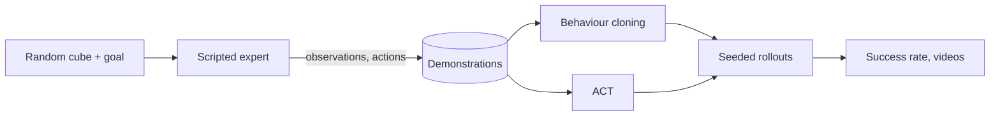

<h1 align="center">Robot arm imitation learning</h1>

<p align="center">
A simulated MuJoCo arm learns pick-and-place from demonstrations: scripted expert, behaviour cloning and action-chunking transformers, compared on seeded rollouts.
</p>

<p align="center">
<a href="https://github.com/haroonkhan02/robot-arm-imitation-learning/actions/workflows/ci.yml"></a>


</p>

<p align="center"></p>

> **Work in progress.** Simulator, expert, demonstrations, behaviour cloning and ACT are
> done and evaluated. Still to come: failure analysis, rollout videos and the final write-up.

## What it does

- A 5-joint arm with a two-finger gripper picks up a cube at a random position and orientation and puts it on a marker at a random goal position (MuJoCo, 20 Hz control).
- A scripted expert (Cartesian waypoints, damped-least-squares IK) solves the task and provides the demonstrations. Policies only see observation-action pairs, never the planner.
- Demonstrations are split by episode, so no trajectory appears in both training and evaluation.
- Evaluation is the success rate over seeded episodes the policies never saw (seeds 50000 and up; demonstrations use 1000 to 1599).



## Results

Success rate on unseen seeds (300 episodes unless noted), trained on 480 clean demonstrations (about 59k frames).

| Controller | Success | Cube lifted |
|---|---|---|
| Scripted expert | 100 % | 100 % |
| MLP behaviour cloning | 0 % | 3 % |
| ACT (chunk 20, temporal ensembling) | 100 % | 100 % |
| ACT, newest chunk only (no ensembling) | 84 % | 98 % |
| ACT trained on noise-perturbed demonstrations | 100 % | 100 % |
| MLP trained on noise-perturbed demonstrations | 0 % | 1 % |

Success rate against the number of training demonstrations (100 episodes each, about 6,000 optimiser steps):

| Demonstrations | 10 | 20 | 50 | 120 |
|---|---|---|---|---|
| ACT | 20 % | 75 % | 99 % | 98 % |
| MLP | 0 % | 0 % | 0 % | 0 % |

The MLP reaches the cube and closes the gripper, then stays there. The expert waits a fixed number of steps
after closing before it lifts, and during that wait the 13-dimensional state does not change, so a
policy that sees only the current state cannot tell "still waiting" from "time to lift". An action chunk
carries the timing with it, which is why ACT works and more data or noisier demonstrations do not help the MLP.
The expert with 0.03 rad execution noise succeeds 84.7 % of the time, so noise-perturbed demonstrations
(507 of 600 episodes kept) are a harder, more varied source; ACT trained on them still reaches 100 %.
Everything is a single seed and the policies see the true cube pose, so these numbers say little about
vision-based policies or real robots.

## Getting started

```bash
uv venv --python 3.12 && source .venv/bin/activate
uv pip install -e ".[dev]"
pytest -q                                   # simulator tests, CPU only

ra-collect --episodes 600 --out data/demos_clean.npz    # about 15 s
ra-expert-eval --episodes 300 --video demo.mp4          # success rate + video

uv pip install -e ".[train]"                            # adds PyTorch
ra-train --policy act --epochs 50 --out models/act.pt   # about 7 min on an M-series GPU (MPS)
ra-policy-eval --ckpt models/act.pt --episodes 300      # seeded rollouts, JSON summary
scripts/run_sweep.sh                                    # demonstration-count and noise sweeps
```

Observations are a 13-vector (joints, gripper opening, cube pose, goal), actions are five
absolute joint targets plus a gripper command. `PickPlaceEnv.render("front" | "top")` returns
camera images for vision-based policies.

## Repository structure

```text
src/robot_arm_il/
  assets/arm_pick_place.xml   MuJoCo model: arm, gripper, cube, goal marker, cameras
  config.py                   dimensions and task randomisation ranges
  env.py                      PickPlaceEnv (reset / step / render)
  kinematics.py               damped-least-squares IK for the gripper site
  expert.py                   scripted pick-and-place expert, run_episode()
  dataset.py                  episode storage, episode-level splits, normalisation
  collect.py                  ra-collect: generate demonstrations
  expert_eval.py              ra-expert-eval: expert success rate and video
  policies.py                 MLP behaviour cloning and ACT (CVAE + transformer, action chunks)
  train.py                    ra-train: train on demonstrations, episode-level validation split
  policy_eval.py              ra-policy-eval: seeded rollouts with temporal ensembling
scripts/run_sweep.sh          demonstration-count and noisy-demonstration runs
tests/                        57 tests (env, IK, expert, dataset, policies, training)
reports/                      expert baseline and per-episode policy results (JSON)
```

## Design decisions

- **Own environment instead of a packaged benchmark.** I wanted full control over the task, the physics and the expert, and a simulator fast enough (about 5,000 control steps per second with the expert and its IK on a laptop CPU) that hundreds of rollouts per evaluation are cheap.
- **Joint-position actions.** The policy outputs absolute joint targets, as in ACT and ALOHA, rather than end-effector deltas, so it never needs the IK solver.
- **Own small ACT instead of a library.** The policy sees a state vector, so a 1.3M-parameter CVAE transformer trains in minutes and every part is visible. At inference the latent is zero and chunks overlap with exponential temporal ensembling.
- **Four equivalent grasp yaws.** The cube and the gripper are both symmetric under 90-degree turns. IK from the home pose can pick the solution that winds the wrist roll into its limit, so the expert solves all four and keeps the smallest roll.
- **Finger armature.** With light fingers the grip force chattered and the cube slid out during transport (35 of 40 seeds). Giving the finger joints some armature fixed it without changing the control gains much.

## Limitations and next steps

- The task is state-based pick-and-place with one cube in a small workspace; there is no sim-to-real transfer.
- The expert is privileged (it reads the true cube pose), so a vision policy has to infer the pose from pixels.
- Next: failure analysis of the ACT misses at small data sizes, rollout videos, a history-aware MLP to confirm the explanation above.

## License

MIT, see [LICENSE](LICENSE).
